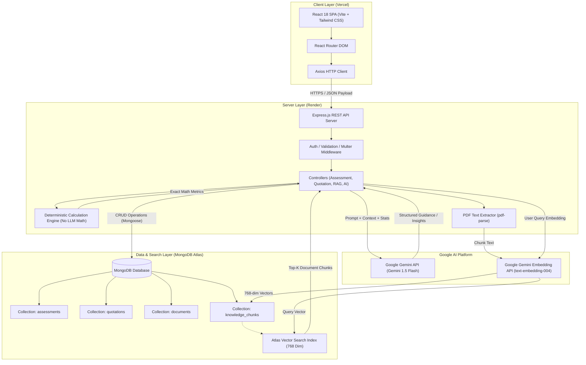
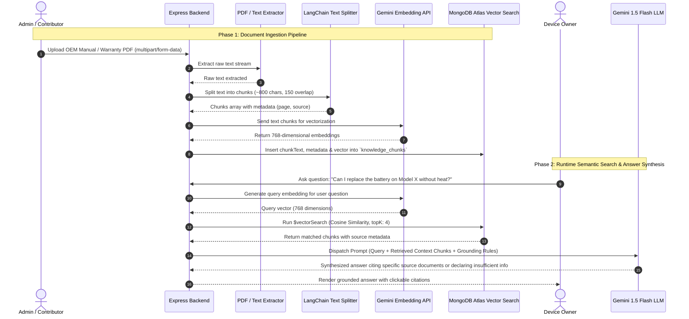
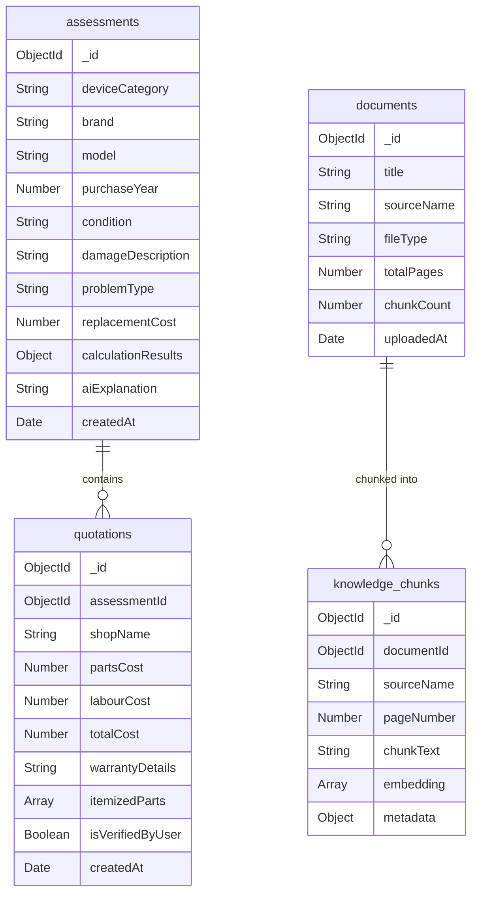
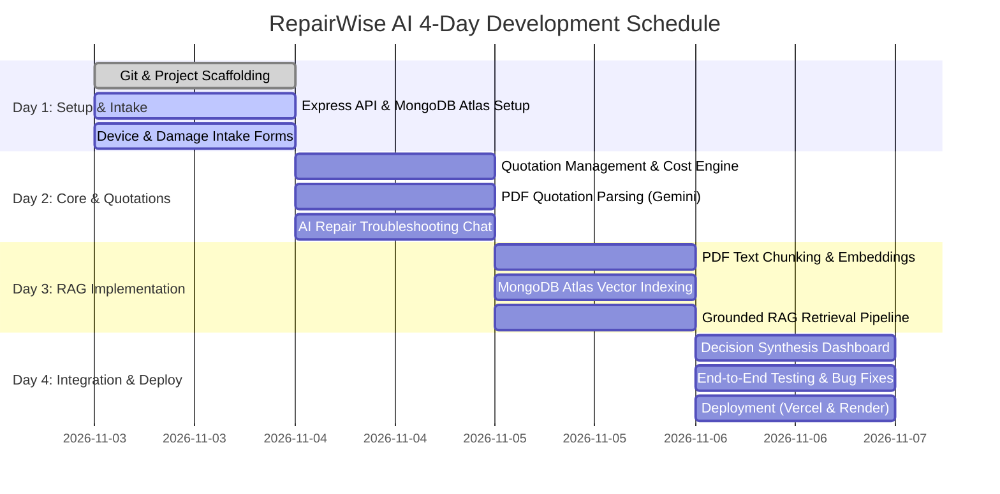

# RepairWise AI 🔧📱

> **An AI-powered decision-support web application helping consumers make informed, transparent, and economically sound choices between repairing and replacing damaged electronic devices.**

---

[](#four-day-development-roadmap)
[](#technology-stack)
[](#project-architecture)
[](LICENSE)

---

## 📌 Table of Contents
1. [Project Information](#1-project-information)
2. [Problem Statement](#2-problem-statement)
3. [Proposed Solution](#3-proposed-solution)
4. [Technology Stack](#4-technology-stack)
5. [System Architecture](#5-project-architecture)
6. [RAG Pipeline Deep Dive](#6-rag-pipeline-deep-dive)
7. [Core Features](#7-main-features)
8. [Database Collections & Schemas](#8-database-collections)
9. [Suggested Folder Structure](#9-suggested-folder-structure)
10. [REST API Reference](#10-api-endpoints)
11. [Installation and Setup Guide](#11-installation-and-setup)
12. [Four-Day Development Roadmap](#12-four-day-development-roadmap)
13. [Testing Scenarios & Edge Cases](#13-testing-scenarios)
14. [Scope Management: MVP vs. Future Scope](#14-scope-management)
15. [Technical, Safety & Ethical Considerations](#15-important-technical-and-safety-considerations)
16. [Project Media & Demonstration](#16-project-media--demonstration)
17. [Conclusion & Sustainability Impact](#17-conclusion)

---

## 1. Project Information

| Property | Details |
| :--- | :--- |
| **Project Name** | **RepairWise AI** |
| **Project Type** | AI-Powered Decision Support Web Application |
| **Planned Development Sprint** | 4 Days (Intensive Hackathon / Milestone Track) |
| **Primary Target Audience** | Everyday consumers, student electronics owners, gadget enthusiasts, and repair-conscious users |
| **Primary Goal** | Help users evaluate whether to repair or replace broken electronics by combining AI-assisted damage insights, structured quotation parsing, document-grounded repair knowledge, and rule-based cost metrics. |

---

## 2. Problem Statement

Every year, millions of smartphones, laptops, tablets, and consumer appliances suffer physical or functional damage. When this happens, consumers face a difficult dilemma: **Should they repair the device or purchase a replacement?**

Currently, making this decision is frustrating and inefficient due to several key factors:
- **Asymmetric Information:** Device owners often lack technical knowledge about hardware components, making it difficult to understand technician quotes or assess whether a quoted price is fair.
- **Scattered & Complex Pricing:** Repair estimates, replacement device market values, and technician labour rates are scattered across different shops and websites without standardized formatting.
- **Hidden Repair Costs:** Quotations frequently bundle parts, labour, diagnostics, and warranty guarantees ambiguously, making quote-to-quote comparisons difficult.
- **Environmental & Financial Waste:** Uncertain users often default to discarding repairable devices and purchasing new ones, inflating consumer expenses and accelerating the global accumulation of toxic electronic waste (e-waste).

---

## 3. Proposed Solution

**RepairWise AI** is an intelligent, transparent repair decision-support platform designed to bring clarity to electronic device maintenance. 

Instead of relying on guesswork, RepairWise AI bridges the information gap by:
1. **Structuring Device Assessments:** Gathering structured information regarding device model, age, condition, and observed damage.
2. **Standardizing Repair Quotations:** Parsing unstructured PDF repair estimates into structured breakdowns (parts, labour, warranty, diagnostics).
3. **Retrieving Grounded Knowledge (RAG):** Indexing official OEM repair guides, warranty documents, and device manuals using vector search to provide factual, contextual repair considerations.
4. **Enforcing Rule-Based Cost Comparisons:** Executing deterministic mathematical calculations (lowest/highest/average quotes, replacement price delta, repair cost percentage) rather than letting an AI hallucinate financial figures.
5. **Synthesizing Objective Insights:** Utilizing Google Gemini to produce plain-language pros and cons, highlight missing information, and formulate pointed questions for local technicians.

### ⚠️ Explicit Non-Goals & Ethical Boundaries
To ensure user safety and ethical software practices, **RepairWise AI explicitly does NOT**:
- Guarantee an unbiased or final verdict on whether a user *must* repair or replace their device.
- Claim to accurately diagnose internal hardware faults purely from textual descriptions or uploaded images.
- Accuse, label, or identify technicians as "dishonest" or "scammers" based solely on quote amounts or pricing variances.

---

## 4. Technology Stack

The platform is designed around modern, robust, and cost-effective web and AI technologies:

```
┌────────────────────────────────────────────────────────────────────────┐
│                          REPAIRWISE AI STACK                           │
├────────────────────────────────┬───────────────────────────────────────┤
│ Frontend                       │ React.js (v18+), Vite, Tailwind CSS,  │
│                                │ Axios, React Router DOM, Lucide Icons │
├────────────────────────────────┼───────────────────────────────────────┤
│ Backend Runtime & Framework    │ Node.js (v20 LTS), Express.js (REST) │
├────────────────────────────────┼───────────────────────────────────────┤
│ Database & Vector Storage      │ MongoDB Atlas, Mongoose ODM,           │
│                                │ Atlas Vector Search                   │
├────────────────────────────────┼───────────────────────────────────────┤
│ Artificial Intelligence (LLM)  │ Google Gemini API (Gemini 1.5 Flash)  │
├────────────────────────────────┼───────────────────────────────────────┤
│ Embeddings Model               │ Google Gemini Embedding API            │
│                                │ (text-embedding-004, 768 dimensions)  │
├────────────────────────────────┼───────────────────────────────────────┤
│ Document & PDF Processing      │ pdf-parse, LangChain.js Text Splitters│
│                                │ Multer (Local/Memory Multipart Upload)│
├────────────────────────────────┼───────────────────────────────────────┤
│ Development & Collaboration    │ Git, GitHub, Postman, Visual Studio   │
│                                │ Code (VS Code)                        │
├────────────────────────────────┼───────────────────────────────────────┤
│ Production Deployment (Target) │ Vercel (Frontend SPA),                │
│                                │ Render (Backend Web Service)          │
└────────────────────────────────┴───────────────────────────────────────┘
```

---

## 5. Project Architecture

The architecture separates presentation, API orchestration, persistent data storage, deterministic calculations, and AI inference.

### High-Level Architecture Diagram



### Component Communication Details

1. **Frontend to Backend:** The React single-page application communicates asynchronously with the Express backend using configured Axios instances. Form submissions, file uploads, and search queries are dispatched as RESTful requests (`application/json` or `multipart/form-data`).
2. **Backend to Calculation Engine:** Financial figures (quotation prices, replacement cost estimates) are passed directly into an isolated JavaScript utility module. The math is calculated deterministically with zero LLM intervention.
3. **Backend to MongoDB Atlas:** Metadata, device assessment reports, and quotation records are validated with Mongoose schemas and stored in standard BSON collections.
4. **Backend to Gemini Embedding API:** During document ingestion or live question answering, raw text strings are converted into 768-dimensional dense vectors using the `text-embedding-004` model.
5. **Backend to MongoDB Atlas Vector Search:** Query embeddings are matched against document chunk vectors using the `$vectorSearch` aggregation pipeline operator to retrieve the most semantically relevant passages.
6. **Backend to Gemini LLM:** Pre-computed mathematical outputs, user problem statements, and retrieved document snippets are composed into a strict system prompt for Gemini 1.5 Flash to synthesize safe, explanatory summaries.

---

## 6. RAG Pipeline Deep Dive

The Retrieval-Augmented Generation (RAG) assistant grounds AI responses in verified technical repair literature (such as OEM manuals, iFixit teardowns, warranty guidelines, and device specification sheets), preventing hallucinated repair advice.

### Step-by-Step RAG Pipeline



#### Detailed Ingestion & Query Stages
1. **Document Ingestion:** Trusted PDFs are received via Multer.
2. **Text Extraction:** Raw text is extracted using `pdf-parse`.
3. **Chunking:** Text is partitioned into small semantic segments (e.g., 500–800 characters with 100–150 character overlap) using recursive character splitting.
4. **Vector Embedding:** Each chunk is converted into an embedding using Google's `text-embedding-004`.
5. **Atlas Storage:** Chunks are saved in `knowledge_chunks` with `documentId`, `sourceName`, `pageNumber`, and `embedding`.
6. **Runtime Query Vectorization:** When a user poses a question, the server vectorizes the query.
7. **Atlas `$vectorSearch`:** An Approximate Nearest Neighbor (ANN) search locates the top-K chunks based on cosine distance.
8. **Prompt Augmentation:** Chunks are placed inside a `[CONTEXT]` block in the prompt, with instructions:
   > *"If the provided context does not contain sufficient details to answer the user's question, clearly state that the knowledge base lacks this information. Do not fabricate repair procedures."*
9. **Citation Response:** The resulting output references the source document and page number.

---

## 7. Main Features

### A. Device Information
Users specify the identity and baseline parameters of their device to ground the assessment:
- **Device Category:** Smartphone, Laptop, Tablet, Smartwatch, Audio/Headphones, Gaming Console.
- **Brand & Model:** Manufacturer name and specific model number (e.g., *Apple iPhone 13 Pro*, *Dell XPS 15 9520*).
- **Purchase Year & Initial Cost:** Helps determine depreciation and relative financial worth.
- **Device Physical Condition:** Pristine, Good, Fair, Heavily Used, Previously Repaired.

### B. Damage Reporting
Enables users to catalog physical and functional failure modes:
- **Primary Damage Category:** Cracked Screen/Display, Battery Degradation, Liquid Ingestion, Charging Port Failure, Logic Board/Bootloop, Audio/Speaker Fault.
- **Narrative Damage Description:** Free-text input describing when and how the issue started.
- **Co-existing Issues:** Checkboxes for secondary flaws (e.g., degraded battery alongside a cracked screen).

### C. AI Repair Assistant
A conversational diagnostic triage tool powered by Gemini:
- Interprets user-submitted symptoms in plain conversational language.
- Highlights potential causes (e.g., *"A failure to charge could stem from debris in the port, a worn-out flex cable, or a faulty charging IC"*).
- Generates a **Technician Inquiry Checklist** (targeted technical questions users should ask when visiting a repair shop).
- **Uncertainty Guardrail:** The assistant always informs the user that software descriptions cannot substitute for hands-on electrical bench testing.

### D. AI Quotation Analyzer
Converts unstructured paper/digital repair estimates into clear tabular data:
- **PDF Upload:** Accepts quotation sheets issued by third-party or authorized shops.
- **Key Information Extraction:**
  - Repair facility / technician name.
  - Itemized replacement parts (screens, batteries, adhesives).
  - Labour and diagnostic fees.
  - Applicable sales tax.
  - Warranty period (e.g., 90-day warranty on parts).
- **Human-in-the-Loop Review:** Users can review, edit, or append extracted fields prior to final computation.
- **Multi-Quote Comparison:** Compares up to 5 quotes side-by-side.

### E. RAG Knowledge Assistant
- Answers user inquiries using indexed manufacturer repair manuals, teardowns, and warranty policies.
- Automatically cites reference documents (e.g., `Source: ThinkPad_T14_Gen2_Hardware_Maintenance_Manual.pdf, Page 42`).
- Disclaims answers when no relevant documentation is indexed, avoiding speculative technical guidance.

### F. Repair vs. Replacement Calculator
A deterministic, rule-based computational engine operating without LLM randomness.

#### Applied Mathematical Formulas

$$\text{Repair Cost Percentage} = \left( \frac{\text{Repair Cost}}{\text{Estimated Replacement Cost}} \right) \times 100$$

$$\text{Cost Difference} = \text{Estimated Replacement Cost} - \text{Repair Cost}$$

#### Calculated Metrics:
- **Lowest Quotation ($Q_{min}$)**
- **Highest Quotation ($Q_{max}$)**
- **Average Quotation ($\bar{Q}$)**
- **Cost Difference compared to replacement**
- **Repair Cost Ratio (%)**
- *Transparent Guidance Note:* All comparisons represent immediate out-of-pocket expenses and do not represent guaranteed long-term economic gains.

### G. AI Decision Explanation
Synthesizes device age, physical condition, user damage reports, deterministic calculations, and retrieved RAG context:
- Explains why repair is advantageous (e.g., lower immediate outlay, environmental sustainability, data preservation).
- Explains why replacement might be sensible (e.g., repair cost exceeds 60% of replacement value, multiple failing sub-systems).
- Highlights missing variables (e.g., unknown technician warranty, salvage value).
- Recommends verification steps before committing funds.

### H. Assessment History
Users can save, revisit, export, and delete past device assessments, allowing them to track quotes over time.

---

## 8. Database Collections

MongoDB Atlas stores all application data across four core collections:



### Collection Schemas & Field Definitions

#### 1. `assessments`
Stores the overarching evaluation session for a specific device.
- `_id` *(ObjectId)*: Unique identifier.
- `deviceCategory` *(String)*: Type of device (e.g., `Smartphone`).
- `brand` *(String)*: Manufacturer name.
- `model` *(String)*: Model designation.
- `purchaseYear` *(Number)*: Year acquired.
- `condition` *(String)*: Physical state rating.
- `damageDescription` *(String)*: User narrative of failure.
- `problemType` *(String)*: Categorized malfunction.
- `replacementCost` *(Number)*: Market replacement price estimate.
- `calculationResults` *(Object)*: Deterministic outputs (`lowestQuote`, `averageQuote`, `repairRatio`, `costDifference`).
- `aiExplanation` *(String)*: Synthesized decision summary from Gemini.
- `createdAt` / `updatedAt` *(Date)*: Timestamps.

#### 2. `quotations`
Itemized repair quotes linked to a specific assessment.
- `_id` *(ObjectId)*: Unique identifier.
- `assessmentId` *(ObjectId)*: Reference to the parent assessment.
- `shopName` *(String)*: Repair facility name.
- `partsCost` *(Number)*: Cost of replacement components.
- `labourCost` *(Number)*: Labour fees.
- `totalCost` *(Number)*: Total quote amount.
- `warrantyDetails` *(String)*: Repair warranty duration and terms.
- `itemizedParts` *(Array of Strings)*: Specific parts listed.
- `isVerifiedByUser` *(Boolean)*: Confirmed by user after PDF extraction.

#### 3. `documents`
Metadata records for uploaded knowledge base publications.
- `_id` *(ObjectId)*: Unique identifier.
- `title` *(String)*: Clean publication title.
- `sourceName` *(String)*: Original filename.
- `fileType` *(String)*: MIME format (e.g., `application/pdf`).
- `totalPages` *(Number)*: Total extracted pages.
- `chunkCount` *(Number)*: Number of generated chunks.
- `uploadedAt` *(Date)*: Ingestion timestamp.

#### 4. `knowledge_chunks`
Vectorized text snippets queried during RAG execution.
- `_id` *(ObjectId)*: Unique identifier.
- `documentId` *(ObjectId)*: Foreign key reference to parent `documents._id`.
- `sourceName` *(String)*: Parent filename for citation display.
- `pageNumber` *(Number)*: Originating PDF page.
- `chunkText` *(String)*: Extracted snippet text.
- `embedding` *(Array of Doubles)*: **768-dimensional float array** generated by `text-embedding-004`.
- `metadata` *(Object)*: Arbitrary supplemental tags (e.g., device tags, category).

---

## 9. Suggested Folder Structure

A clean, modular monorepo-style folder architecture separating client and server:

```
RepairWise-AI/
├── .gitignore
├── README.md
├── package.json
│
├── client/                                 # Frontend Application (React + Vite)
│   ├── index.html
│   ├── package.json
│   ├── vite.config.js
│   ├── tailwind.config.js
│   ├── postcss.config.js
│   ├── .env.example
│   └── src/
│       ├── main.jsx
│       ├── App.jsx
│       ├── index.css
│       ├── api/
│       │   └── axiosClient.js             # Configured Axios instance
│       ├── components/                    # Reusable Presentation Components
│       │   ├── common/
│       │   │   ├── Navbar.jsx
│       │   │   ├── Footer.jsx
│       │   │   ├── Button.jsx
│       │   │   ├── Modal.jsx
│       │   │   └── AlertBanner.jsx
│       │   ├── forms/
│       │   │   ├── DeviceInfoForm.jsx     # Device metadata entry
│       │   │   ├── DamageReportForm.jsx   # Damage categorization
│       │   │   └── QuotationUploadForm.jsx# PDF upload & manual entry
│       │   ├── calculator/
│       │   │   ├── CostMetricsCard.jsx    # Numerical comparison widget
│       │   │   └── QuotationTable.jsx     # Side-by-side quote review
│       │   ├── rag/
│       │   │   ├── KnowledgeSearch.jsx    # Manual query input
│       │   │   └── SourceCitationBadge.jsx# Clickable PDF source tags
│       │   └── ai/
│       │       ├── AssistantChat.jsx      # Gemini interactive assistant
│       │       └── DecisionSummary.jsx    # Final AI pros/cons breakdown
│       ├── pages/                         # Application Views
│       │   ├── Home.jsx                   # Landing page
│       │   ├── NewAssessment.jsx          # Multi-step intake flow
│       │   ├── AssessmentDetails.jsx      # Decision & comparison view
│       │   ├── KnowledgeBase.jsx          # Document search interface
│       │   └── History.jsx                # Saved assessment list
│       ├── services/                      # Client-side API Calls
│       │   ├── assessmentService.js
│       │   ├── quotationService.js
│       │   └── ragService.js
│       └── utils/
│           ├── formatters.js              # Currency, date, percentage helpers
│           └── validators.js              # Form input validation rules
│
└── server/                                # Backend Application (Node.js + Express)
    ├── package.json
    ├── server.js                          # Express entry point
    ├── .env.example
    ├── config/
    │   ├── db.js                          # MongoDB connection setup
    │   └── gemini.js                      # Gemini client initialization
    ├── models/                            # Mongoose Schemas
    │   ├── Assessment.js
    │   ├── Quotation.js
    │   ├── Document.js
    │   └── KnowledgeChunk.js
    ├── controllers/                       # Request Handlers
    │   ├── assessmentController.js
    │   ├── quotationController.js
    │   ├── ragController.js
    │   └── aiController.js
    ├── routes/                            # Express Route Definitions
    │   ├── assessmentRoutes.js
    │   ├── quotationRoutes.js
    │   ├── ragRoutes.js
    │   └── aiRoutes.js
    ├── middleware/                        # Custom Middlewares
    │   ├── errorHandler.js                # Centralized error handler
    │   ├── fileUpload.js                  # Multer PDF handling
    │   └── validateRequest.js             # Payload validation
    ├── ai/                                # Gemini API Orchestration
    │   ├── geminiClient.js                # LLM request wrappers
    │   ├── promptTemplates.js             # Structured prompt templates
    │   └── quotationExtractor.js          # PDF-to-JSON parsing logic
    ├── rag/                               # RAG Utilities
    │   ├── pdfProcessor.js                # pdf-parse text extraction
    │   ├── textChunker.js                 # Recursive character splitting
    │   ├── embeddingService.js            # Calls to text-embedding-004
    │   └── vectorSearchService.js         # MongoDB $vectorSearch queries
    ├── utils/                             # Core Utilities
    │   ├── calculationEngine.js           # Deterministic math engine
    │   └── logger.js                      # Structured console logging
    └── uploads/                           # Temporary storage for PDFs
        └── .gitkeep
```

---

## 10. API Endpoints

The Express server exposes standard RESTful endpoints:

| Method | Endpoint | Purpose | Request Body / Params | Expected Response |
| :--- | :--- | :--- | :--- | :--- |
| `GET` | `/api/health` | Service health status check | None | `{ status: "ok", timestamp: ISOString }` |
| `POST` | `/api/assessments` | Create a new device assessment session | JSON: device details, condition, damage info | `{ success: true, assessment: { ... } }` |
| `GET` | `/api/assessments` | Retrieve all saved assessments | None (supports `?limit=&page=`) | `{ assessments: [ ... ] }` |
| `GET` | `/api/assessments/:id` | Fetch complete details of a single assessment | URL Param: `id` | `{ assessment: { ... }, quotations: [ ... ] }` |
| `PUT` | `/api/assessments/:id` | Update assessment details | JSON: fields to update | `{ success: true, updated: { ... } }` |
| `DELETE` | `/api/assessments/:id` | Delete an assessment and linked quotations | URL Param: `id` | `{ success: true, message: "Deleted" }` |
| `POST` | `/api/quotations` | Manually add a repair quotation | JSON: shop name, parts cost, labour, warranty | `{ success: true, quotation: { ... } }` |
| `POST` | `/api/quotations/analyze-pdf` | Upload and parse a PDF repair estimate | `multipart/form-data`: `file` (PDF) | `{ extractedData: { shop, parts, labour, warranty } }` |
| `POST` | `/api/ai/repair-assistant` | Ask general repair troubleshooting questions | JSON: `{ query, deviceContext }` | `{ answer: string, technicianQuestions: [] }` |
| `POST` | `/api/rag/documents` | Upload and vectorize an OEM manual / guide | `multipart/form-data`: `file` (PDF) | `{ documentId: string, chunksIndexed: number }` |
| `POST` | `/api/rag/query` | Query knowledge base with vector search | JSON: `{ query: string, topK?: number }` | `{ answer: string, sources: [ { file, page } ] }` |
| `POST` | `/api/ai/decision-report/:id` | Generate synthesized decision explanation | URL Param: `id` | `{ mathMetrics: {}, aiExplanation: string }` |

---

## 11. Installation and Setup

Follow these step-by-step instructions to set up RepairWise AI locally.

### Prerequisites
- **Node.js**: v18.0.0 or later (v20 LTS recommended)
- **npm** or **yarn**
- **MongoDB Atlas Account** with an active M0 (free) or dedicated cluster
- **Google AI Studio API Key** (for Gemini 1.5 Flash and Gemini Embeddings)
- **Git**

---

### Step 1: Clone the Repository & Create Working Branch
```bash
git clone https://github.com/<your-username>/RepairWise-AI.git
cd RepairWise-AI
git checkout -b feature/setup-and-foundations
```

---

### Step 2: Backend Setup

1. **Navigate to the server directory:**
   ```bash
   cd server
   ```

2. **Initialize and install backend dependencies:**
   ```bash
   npm install express mongoose dotenv cors multer pdf-parse @google/genai
   npm install --save-dev nodemon
   ```

3. **Configure Environment Variables:**
   Create a `.env` file in the `server/` root (refer to `.env.example` below):
   ```bash
   cp .env.example .env
   ```

---

### Step 3: Frontend Setup

1. **Navigate to the client directory (from the repository root):**
   ```bash
   cd ../client
   ```

2. **Initialize a React application with Vite (if not already initialized):**
   ```bash
   npm create vite@latest . -- --template react
   ```

3. **Install frontend dependencies:**
   ```bash
   npm install axios react-router-dom lucide-react
   ```

4. **Install and configure Tailwind CSS:**
   ```bash
   npm install -D tailwindcss postcss autoprefixer
   npx tailwindcss init -p
   ```

5. **Configure Tailwind Template Paths:**
   Update `client/tailwind.config.js`:
   ```javascript
   /** @type {import('tailwindcss').Config} */
   export default {
     content: [
       "./index.html",
       "./src/**/*.{js,ts,jsx,tsx}",
     ],
     theme: {
       extend: {},
     },
     plugins: [],
   }
   ```

6. **Add Tailwind Directives to CSS:**
   Ensure `client/src/index.css` contains:
   ```css
   @tailwind base;
   @tailwind components;
   @tailwind utilities;
   ```

7. **Configure Frontend Environment:**
   ```bash
   cp .env.example .env
   ```

---

### Step 4: MongoDB Atlas Vector Search Index Configuration

To enable semantic search for the RAG assistant, configure a vector search index in MongoDB Atlas:

1. Log in to [MongoDB Atlas](https://cloud.mongodb.com/).
2. Navigate to your cluster > **Browse Collections**.
3. Select the `knowledge_chunks` collection (create it if not yet present).
4. Click the **Search Indexes** tab > **Create Search Index**.
5. Select **Atlas Vector Search (JSON Editor)**.
6. Target the database and collection `knowledge_chunks`.
7. Name the index: `vector_index`.
8. Paste the following configuration:

```json
{
  "fields": [
    {
      "type": "vector",
      "path": "embedding",
      "numDimensions": 768,
      "similarity": "cosine"
    },
    {
      "type": "filter",
      "path": "documentId"
    }
  ]
}
```

> **Note on Dimensions:** Google's `text-embedding-004` outputs vectors with **768 dimensions**. Ensure `numDimensions` is set to exactly `768`.

---

### Step 5: Environment Files Configuration

#### `server/.env.example`
```env
# Server Configuration
PORT=5000
NODE_ENV=development
CLIENT_URL=http://localhost:5173

# Database Connection
MONGODB_URI=mongodb+srv://<username>:<password>@cluster0.mongodb.net/repairwise?retryWrites=true&w=majority

# Google Gemini API
GEMINI_API_KEY=your_gemini_api_key_here
GEMINI_LLM_MODEL=gemini-1.5-flash
GEMINI_EMBEDDING_MODEL=text-embedding-004

# Vector Search Settings
VECTOR_INDEX_NAME=vector_index
```

#### `client/.env.example`
```env
# Frontend API Configuration
VITE_API_BASE_URL=http://localhost:5000/api
```

---

### Step 6: Running the Application Locally

1. **Start the Express backend:**
   ```bash
   cd server
   npm run dev
   # Runs on http://localhost:5000
   ```

2. **Start the React frontend (in a separate terminal):**
   ```bash
   cd client
   npm run dev
   # Runs on http://localhost:5173
   ```

3. Open `http://localhost:5173` in your browser.

---

## 12. Four-Day Development Roadmap

This 4-day plan outlines the milestones for an intensive hackathon or rapid development sprint.



### Day-by-Day Milestone Breakdown

```
DAY 1: Foundation, Infrastructure & Intake Forms
├── [ ] Initialize GitHub repository and feature branching scheme
├── [ ] Scaffold React frontend with Vite & Tailwind CSS
├── [ ] Set up Express backend with CORS and central error handling
├── [ ] Connect MongoDB Atlas with Mongoose connection validation
├── [ ] Verify full-stack connectivity via health-check endpoint
├── [ ] Build Device Information Form component
├── [ ] Build Damage Reporting Form component
└── Expected Deliverable: Working frontend-backend skeleton with functional device intake stored in MongoDB.

DAY 2: Core Quotation Features, Calculation Engine & Gemini Assistant
├── [ ] Build Multi-Quotation entry interface
├── [ ] Implement deterministic Cost Calculation Engine (min/max/avg, ratio, delta)
├── [ ] Integrate Google Gemini API SDK into Express backend
├── [ ] Build interactive AI Repair Assistant chat interface
├── [ ] Implement backend PDF upload with Multer and text extraction via pdf-parse
├── [ ] Prompt Gemini to extract structured JSON data from raw quotation text
├── [ ] Build a verification UI for users to review and edit extracted quotes
└── Expected Deliverable: Interactive AI chat, working cost comparison calculator, and automated PDF quotation extraction.

DAY 3: Document Ingestion, Embeddings & RAG Implementation
├── [ ] Curate sample repair guides and warranty reference PDFs
├── [ ] Build backend text chunking utility (~800 characters with overlap)
├── [ ] Generate vector embeddings using Google's text-embedding-004
├── [ ] Store chunk records with vectors and source metadata in MongoDB Atlas
├── [ ] Configure and verify Atlas Vector Search Index (768 dimensions, cosine similarity)
├── [ ] Implement semantic retrieval service using $vectorSearch pipeline
├── [ ] Build prompt augmentation logic (retrieved snippets + grounding instruction)
├── [ ] Implement UI for knowledge queries with clickable source citations
└── Expected Deliverable: Fully functional RAG assistant providing cited answers from indexed repair documentation.

DAY 4: Integration, Hardening, Polish & Deployment
├── [ ] Assemble Decision Explanation Dashboard combining math, condition, and AI insights
├── [ ] Implement Assessment History page (view, inspect, and delete past sessions)
├── [ ] Validate safety guardrails and input validation across all endpoints
├── [ ] Execute test suite covering edge cases (missing quotes, PDF errors, zero values)
├── [ ] Polish user interface for mobile responsiveness and accessibility
├── [ ] Deploy backend to Render and verify environment secrets
├── [ ] Deploy frontend SPA to Vercel and set production API base URL
└── Expected Deliverable: Fully functional, deployed MVP ready for demonstration and evaluation.
```

---

## 13. Testing Scenarios

The platform is designed to handle common real-world edge cases:

| Scenario / Edge Case | Condition Tested | Expected System Behavior |
| :--- | :--- | :--- |
| **1. Repair Far Cheaper Than Replacement** | Total Repair: \$80, Replacement: \$800 (10% ratio) | Calculation engine shows high cost savings. AI advises that repairing is financially sensible, subject to technician warranty. |
| **2. Repair Exceeds Replacement Cost** | Total Repair: \$450, Replacement: \$350 (128% ratio) | Calculation engine flags negative savings. AI clearly explains that repair is financially impractical unless data recovery is critical. |
| **3. Multiple Varying Quotations** | 3 quotes: \$120, \$210, \$300 | Computes lowest (\$120), highest (\$300), and average (\$210). Prompts user to check why quotes vary (e.g., OEM vs. aftermarket parts). |
| **4. Missing Replacement Price** | User leaves replacement estimate blank | System calculates quote spreads normally. Disables percentage ratio and prompts user for an estimated market replacement price. |
| **5. Invalid Quotation Values** | Negative numbers or non-numeric strings submitted | Mongoose validation and frontend schemas reject input with a clear error message. |
| **6. Corrupted or Scanned Image PDF** | PDF without extractable text uploaded | `pdf-parse` returns empty string. Server notifies user that text extraction failed and opens manual entry form. |
| **7. No Relevant Document Found in RAG** | User asks a question outside the indexed corpus | Vector search returns low-confidence matches. Prompt instructions ensure the model states that information is unavailable rather than guessing. |
| **8. Attempt to Force AI Hallucination** | User asks AI to guarantee a hardware diagnosis | System prompt guardrails engage: assistant explains uncertainty and recommends a physical bench diagnostic. |
| **9. Database Service Interruption** | MongoDB Atlas connection dropped or timed out | Backend catches connection error and returns `503 Service Unavailable` with friendly UI alert. |
| **10. Gemini API Rate Limit / Failure** | Gemini API quota exceeded or network error | Backend catches API exception, preserves deterministic math results, and informs user that AI synthesis is temporarily unavailable. |

---

## 14. Scope Management

To ensure reliable delivery within a 4-day sprint, the feature set is strictly prioritized:

```
┌───────────────────────────────────────────────┬────────────────────────────────────────────────┐
│             MVP (4-DAY SPRINT SCOPE)          │               FUTURE ENHANCEMENTS              │
├───────────────────────────────────────────────┼────────────────────────────────────────────────┤
│ ✅ Device metadata and intake forms           │ 🔮 Computer Vision for device crack/dent       │
│ ✅ Damage categorization & narrative input    │    recognition from uploaded photos            │
│ ✅ Deterministic rule-based math engine       │ 🔮 Optical Character Recognition (OCR) for     │
│ ✅ Multi-quote comparison interface           │    handwritten or photographed paper receipts  │
│ ✅ Gemini AI repair assistant (symptoms)      │ 🔮 Verified local technician marketplace       │
│ ✅ Text-based PDF quotation parsing           │ 🔮 Location-based repair service recommendations│
│ ✅ Document-based RAG assistant with sources  │ 🔮 Live web scraping of refurbished device     │
│ ✅ AI decision explanation synthesis          │    market prices (e.g., eBay, Swappa)          │
│ ✅ Assessment history (save/view/delete)      │ 🔮 Multi-tenant user auth (JWT / OAuth2)       │
│ ✅ Comprehensive system safety guardrails     │ 🔮 Scope 3 e-waste carbon offset estimation    │
└───────────────────────────────────────────────┴────────────────────────────────────────────────┘
```

---

## 15. Important Technical and Safety Considerations

### 1. API Key Isolation
- The Google Gemini API key must reside **strictly on the backend server**.
- The frontend never accesses the AI API directly; all requests flow through Express controllers.
- `.env` files are ignored in `.gitignore` to prevent secret leakage.

### 2. Strict Deterministic Math (No AI Calculations)
- Large Language Models can produce inaccurate arithmetic. **All calculations are executed in pure JavaScript.**
- The calculated metrics are passed into the LLM prompt as read-only facts for verbal synthesis.

### 3. File Upload Safety & Quotas
- Uploads are restricted to `application/pdf` MIME types.
- A strict file size limit (e.g., **5 MB maximum**) is enforced using Multer.
- Files are parsed in-memory or immediately removed from disk after text extraction.

### 4. Transparent Sourcing (RAG Integrity)
- Every response from the RAG assistant includes source documentation references (file name and page number).
- If the knowledge base does not contain relevant content, the model is instructed to acknowledge the limitation rather than speculate.

### 5. Ethical Guidance & Technician Neutrality
- Price variance across quotes can stem from OEM vs. aftermarket parts, technician experience, regional overhead, or warranty coverage.
- The platform **never accuses a technician or shop of being dishonest** based solely on pricing differences.
- The platform reminds users that software assessments cannot replace hands-on testing by a qualified technician.

---

## 16. Project Media & Demonstration

> *Note: Media placeholders will be updated with production assets once deployment and demo recordings are finalized.*

### Application Screenshots

```
┌────────────────────────────────────────────────────────────────────────┐
│                                                                        │
│                    [ SCREENSHOT PLACEHOLDER ]                          │
│               New Assessment Flow & Device Intake Form                 │
│                                                                        │
└────────────────────────────────────────────────────────────────────────┘
```

```
┌────────────────────────────────────────────────────────────────────────┐
│                                                                        │
│                    [ SCREENSHOT PLACEHOLDER ]                          │
│             Quotation Analyzer & Side-by-Side Comparison               │
│                                                                        │
└────────────────────────────────────────────────────────────────────────┘
```

```
┌────────────────────────────────────────────────────────────────────────┐
│                                                                        │
│                    [ SCREENSHOT PLACEHOLDER ]                          │
│         RAG Knowledge Search with Citations & Decision Breakdown        │
│                                                                        │
└────────────────────────────────────────────────────────────────────────┘
```

### Video Demonstration
- 📹 **Walkthrough Video:** *[Demo Video Link Placeholder]*
- 🌐 **Live Web Application:** *[Production Vercel URL Placeholder]*
- ⚙️ **Backend API Status:** *[Production Render API URL Placeholder]*

---

## 17. Conclusion

**RepairWise AI** is designed to address a real consumer problem: the lack of accessible, structured information when deciding whether to fix or replace broken electronics.

By combining deterministic financial calculations with Gemini-powered natural language insights and grounded RAG documentation, the platform provides users with practical, balanced guidance. In doing so, it helps consumers avoid unnecessary expenses, better understand technical repair quotes, and reduce electronic waste through repairability awareness.

---

*Authored for the RepairWise AI Project Initiative.*
