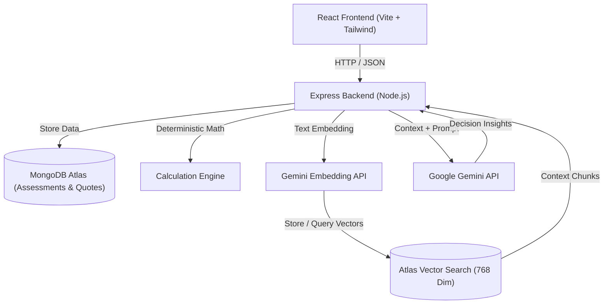

# RepairWise AI 🔧📱

An AI-powered decision-support web application that helps users decide whether to **repair or replace** damaged electronic devices using quotation analysis, document-based knowledge retrieval (RAG), and transparent cost comparisons.

---

## 📌 Overview

- **Project Name:** RepairWise AI
- **Type:** AI-Powered Web Application
- **Sprint Duration:** 4 Days
- **Goal:** Provide clear, data-driven cost and repair feasibility comparisons so users make informed choices and reduce unnecessary e-waste.

### Problem Statement
When electronic devices break, comparing repair costs, technician quotes, and replacement prices is difficult because pricing is fragmented and unclear. As a result, users frequently overpay for repairs or discard fixable devices, increasing e-waste.

### Solution
RepairWise AI aggregates device details, extracts data from repair quotes, performs deterministic cost comparisons, and uses RAG with manufacturer documentation to provide objective insights.

> **⚠️ Important Notice:** RepairWise AI is an informational tool. It does **not** guarantee unbiased decisions, diagnose hardware faults conclusively, or assess technician honesty based on price.

---

## 🛠️ Technology Stack

| Layer | Technologies |
| :--- | :--- |
| **Frontend** | React.js, Vite, Tailwind CSS, Axios, React Router DOM |
| **Backend** | Node.js, Express.js |
| **Database** | MongoDB Atlas, Mongoose ODM |
| **AI & Search** | Google Gemini 1.5 Flash (LLM), Gemini Embedding API (`text-embedding-004`, 768 dimensions), MongoDB Atlas Vector Search |
| **Document Processing** | `pdf-parse`, LangChain.js (text chunking) |
| **Deployment** | Vercel (Frontend), Render (Backend) |

---

## 🏗️ Architecture



---

## ✨ Core Features

- **Device Information:** Record category, brand, model, purchase year, and current condition.
- **Damage Reporting:** Describe symptoms, select problem categories, and note co-existing issues.
- **AI Repair Assistant:** Conversational symptom analysis that highlights potential causes, suggests questions for technicians, and communicates hardware uncertainty.
- **AI Quotation Analyzer:** Upload PDF repair quotes; extract parts, labour, and warranty into editable structured data for multi-quote comparison.
- **RAG Knowledge Assistant:** Answers questions based on indexed OEM manuals and warranties. Cites document sources and explicitly admits when information is missing.
- **Repair vs. Replacement Calculator:** Rule-based calculations (no AI hallucinations):
  - $\text{Cost Difference} = \text{Replacement Cost} - \text{Repair Cost}$
  - $\text{Repair Cost Ratio} = \left(\frac{\text{Repair Cost}}{\text{Replacement Cost}}\right) \times 100$
  - Computes minimum, maximum, and average quotes.
- **AI Decision Explanation:** Synthesizes device condition, quotation stats, and RAG context to outline pros, cons, and factors to verify before paying.
- **Assessment History:** Save, review, and delete previous device evaluations.

---

## 🗄️ Database Collections

1. **`assessments`**: Stores device info, damage details, replacement cost, calculation results, and AI summaries.
2. **`quotations`**: Stores linked repair quotes (`assessmentId`, shop name, parts cost, labour, warranty, items).
3. **`documents`**: Metadata for uploaded manuals (`title`, `sourceName`, `totalPages`, `chunkCount`).
4. **`knowledge_chunks`**: Document snippets for vector search:
   - `documentId`, `sourceName`, `pageNumber`, `chunkText`, `metadata`
   - `embedding`: 768-dimensional float array (`text-embedding-004`)

> **Atlas Vector Index:** Set index on `knowledge_chunks.embedding` with `numDimensions: 768` and `similarity: "cosine"`.

---

## 📂 Project Structure

```
RepairWise-AI/
├── client/                     # Frontend (React + Vite)
│   ├── src/
│   │   ├── api/                # Axios configuration
│   │   ├── components/         # Forms, Calculator, AI, RAG UI
│   │   ├── pages/              # Home, Assessment, History
│   │   └── utils/              # Formatters & helpers
│   ├── tailwind.config.js
│   └── package.json
└── server/                     # Backend (Node.js + Express)
    ├── ai/                     # Gemini client & prompt templates
    ├── rag/                    # Chunking, embeddings & vector search
    ├── config/                 # DB & Gemini configs
    ├── controllers/            # Route handlers
    ├── models/                 # Mongoose schemas
    ├── routes/                 # REST endpoints
    ├── utils/                  # Deterministic calculation engine
    └── server.js
```

---

## 🚀 Quick Start & Installation

### 1. Prerequisites
- Node.js (v18+)
- MongoDB Atlas cluster
- Google Gemini API key

### 2. Backend Setup
```bash
cd server
npm install express mongoose dotenv cors multer pdf-parse @google/genai
npm install --save-dev nodemon
cp .env.example .env
npm run dev
```

**`server/.env.example`**
```env
PORT=5000
MONGODB_URI=your_mongodb_atlas_connection_string
GEMINI_API_KEY=your_gemini_api_key
```

### 3. Frontend Setup
```bash
cd ../client
npm install
npm install axios react-router-dom lucide-react
npm run dev
```

**`client/.env.example`**
```env
VITE_API_BASE_URL=http://localhost:5000/api
```

---

## 🔌 API Endpoints

| Method | Endpoint | Description |
| :--- | :--- | :--- |
| `GET` | `/api/health` | Backend health check |
| `POST` | `/api/assessments` | Create a new device assessment |
| `GET` | `/api/assessments` | List all saved assessments |
| `GET` | `/api/assessments/:id` | Get details and quotes for an assessment |
| `DELETE` | `/api/assessments/:id` | Delete an assessment |
| `POST` | `/api/quotations` | Add a manual repair quote |
| `POST` | `/api/quotations/analyze-pdf` | Extract quote details from uploaded PDF |
| `POST` | `/api/ai/repair-assistant` | Troubleshoot symptoms with Gemini |
| `POST` | `/api/rag/documents` | Upload and vectorize an OEM manual |
| `POST` | `/api/rag/query` | Semantic search with source citations |
| `POST` | `/api/ai/decision-report/:id` | Generate final decision synthesis |

---

## 📅 4-Day Development Roadmap

- [ ] **Day 1: Setup & Intake Forms**
  - Scaffold React + Vite + Tailwind and Express + MongoDB.
  - Build Device Information and Damage Reporting forms.
- [ ] **Day 2: Quotations & AI Chat**
  - Implement Multi-Quote entry and rule-based cost calculator.
  - Implement PDF quotation parser (Gemini extraction).
  - Add AI repair symptom assistant.
- [ ] **Day 3: Document RAG**
  - Implement PDF chunking and Gemini embeddings (`text-embedding-004`).
  - Configure MongoDB Atlas Vector Search index.
  - Build semantic search with document citations.
- [ ] **Day 4: Integration & Deployment**
  - Connect decision explanation dashboard and history page.
  - Test edge cases and input validation.
  - Deploy frontend to Vercel and backend to Render.

---

## 🎯 Scope Management

| In Scope (MVP) | Future Scope |
| :--- | :--- |
| Device & damage intake forms | Image-based crack/damage recognition |
| PDF quote extraction & comparison | OCR for paper receipts |
| Deterministic cost calculations | Local technician marketplace |
| Gemini symptom assistant | Real-time replacement price scrapers |
| Manual-based RAG with citations | User accounts & authentication |

---

## 🔒 Key Safety & Technical Rules

1. **No AI Math:** Financial calculations are strictly computed in code, never generated by the LLM.
2. **Backend API Keys:** Gemini API keys must remain strictly on the backend.
3. **Citations & Fallbacks:** RAG answers cite document sources and state when information is unavailable.
4. **No Technician Accusations:** Pricing variations are presented as estimates, never as accusations of dishonesty.
5. **Hardware Uncertainty:** The assistant states that software cannot replace hands-on testing.

---

## 📸 Media Placeholders

- **Screenshot:** *[App Dashboard Placeholder]*
- **Demo Video:** *[Video Walkthrough Placeholder]*
- **Live Demo:** *[Vercel URL Placeholder]*

---

## 📄 License
This project is open-source and available under the [MIT License](LICENSE).
